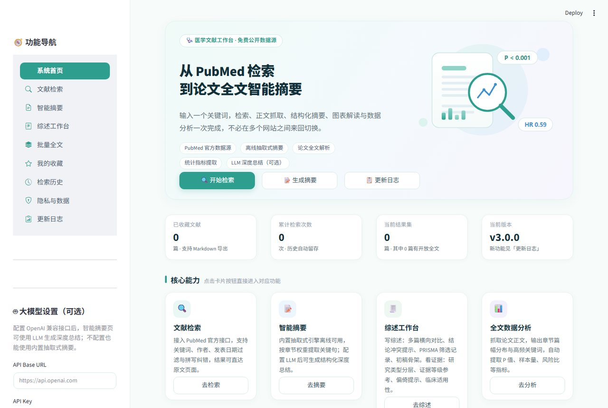
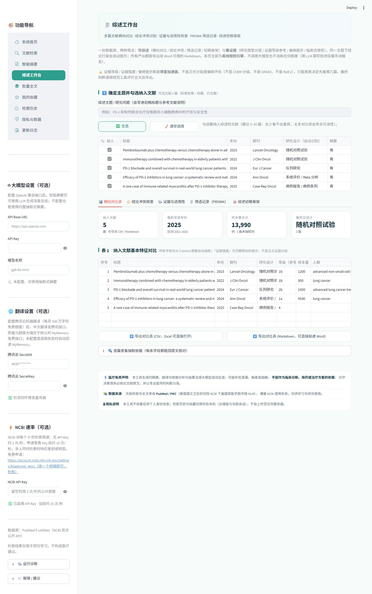
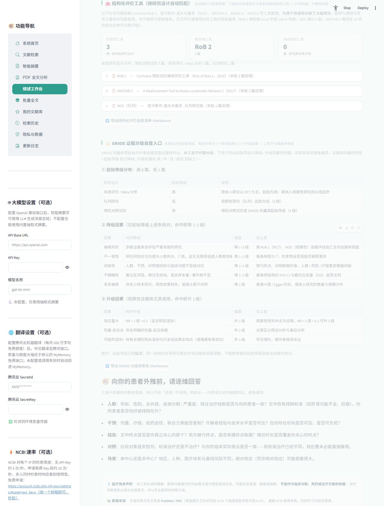

# 医学文献智能摘要与检索系统

PubMed 检索、全文获取、中文摘要、综述初稿，在一个网页里做完。

数据源是 PubMed 官方 API（NCBI E-utilities，免费，不用注册）。全文有三条路：PMC 开放存档、Unpaywall 开放副本、无头浏览器抓发布商页面。摘要、对比表、证据等级这些由本地规则引擎算，不调用大模型，也不花你的额度；只有「结构化总结」和综述的「结果概述 / 讨论」需要你自己配 Key，不配也能用。

<p>
<a href="https://github.com/Fy66666-fy/medical-lit-system/releases/latest"></a>
<a href="LICENSE"></a>


</p>

**[在线直接使用](https://medical-lit-system-fy.streamlit.app/)　·　[Windows 桌面版（可离线）](https://github.com/Fy66666-fy/medical-lit-system/releases/latest)　·　[产品落地页（截图 / 场景 / 技巧）](https://fy66666-fy.github.io/medical-lit-system/)**

<p align="center">
  
</p>

<p align="center">
  
  
</p>

## 它和 PubMed 网页的区别在哪

PubMed 网页管到检索为止，后面读、整理、写，都得自己来。这里把后面几步也接上了。

**读摘要**。摘要默认中英对照，每句都能点回原文，落在哪个章节、第几句、原句是什么，直接标出来。P 值、95%CI、HR / OR / RR、样本量 n、均值±SD 会被自动扫出来标在原句上，Lancet 那种用中点表示小数的情况也认。看英文费劲的话，中文摘要走机器翻译，质量比免费兜底接口好一些，关键术语建议还是对一眼原文。

**拿到全文**。PMC 开放存档、Unpaywall 开放副本、无头浏览器抓发布商页面，三条路依次试。PubMed 里大概两三成是开放获取，剩下抓不到的会自动回落到摘要，并在对比表里标「未抓到」。手里有机构订阅下载的 PDF 也能直接拖进来，分栏、章节、表格都解析，解析结果和 PubMed 文献是同构的，摘要、定位、对比表、引用导出全都能用。单篇默认限 20 MB、200 页，表格最多取 40 张（前 60 页内）。扫描件没有文本层，会直接提示需要先 OCR，不会给一份假装能读的结果。

解析用的是 pdfplumber（MIT）而不是 PyMuPDF。PyMuPDF 快一些，但它是 AGPL-3.0，传染性强，会把整个项目拖进同一个许可框架，这里许可兼容优先于性能。

**横向对比**。选一批文献丢进综述工作台，研究设计、样本量、人群、主要终点、效应量、结论会自己填成一张表。每个格子都附原文片段，点一下就能回去核对。空格分三种写：摘要未提及、⚠️ 有摘要未抽到、无摘要。前一种是原文真没写，第二种是工具漏了，该回原文补，第三种只能回全文。每篇另给一个结构化完整度 x/6，按研究设计、样本量、人群、主要终点、关键效应量、结论六个字段算。这不是质量分，抽不到只说明摘要没写或写法罕见，与研究的价值无关，用途是让你一眼看出哪几篇值得回原文补。

纳入多少篇合适：3 篇以下做对比表意义不大；超过 30 篇建议先按分组收窄到同一人群、同一终点再比。结论冲突核查在 5 到 20 篇时最好用。

**结论打架的地方**。同一主题下结论方向不一致时会提示，顺便列出可能的原因：人群不同、剂量不同、终点定义不同、随访时长不同。只提示要核对，不判断谁对谁错。

**证据能不能用**。研究类型先分层（干预性 / 观察性 / 描述性 / 二次研究 / 基础研究），再给一个牛津 CEBM 简化等级作参考。注意这个等级没考虑偏倚、间接性和不一致性，只能用来决定先看哪几篇，不能写进方法学部分。偏倚提示有 32 条，级别只分「重点核对 / 建议核对 / 信息缺失」三档。摘要里没写的归到「信息缺失」，不和真正的风险提示混在一起。

需要正式评价时，按研究设计给对应的信号问题清单：

| 研究设计 | 工具 | 结构 |
|---|---|---|
| 随机对照试验 | RoB 2 | 5 个域 |
| 队列研究 | NOS 队列版 | 选择 4 星 + 可比性 2 星 + 结局 3 星 = 9 星 |
| 病例对照研究 | NOS 病例对照版 | 选择 4 星 + 可比性 2 星 + 暴露 3 星 = 9 星 |
| 横断面研究 | 改良 NOS | 选择 5 星 + 可比性 2 星 + 结局 3 星 = 10 星 |
| 系统评价 / Meta 分析 | AMSTAR-2 | 16 项，其中 7 项关键域已标注 |
| 临床指南 / 专家共识 | AGREE II | 6 个域共 23 项 |
| 叙述性综述 | SANRA | 6 项，满分 12 分 |
| 病例报告 / 病例系列 | CARE | 13 项，这是报告规范，不是偏倚工具 |
| 基础 / 动物实验 | SYRCLE | 10 项 |

这些是必须回全文逐条回答的问题，不是结论，每份都注明真实出处，题项为便于快速核对做了简化，不是原版量表的完整复现，正式评价请用原版。GRADE 那边给起始等级（RCT 高、观察性低、病例报告极低、动物与叙述性综述不适用）、5 个降级因素和 3 个升级因素的判据与查法，最终等级不代填。

**引用导出**。BibTeX / RIS / EndNote / MEDLINE / Vancouver / GB/T 7714 六种，检索结果、收藏、综述纳入文献都能导。卷、期、页码、ISSN、团体作者在检索阶段就一并取回来了，导进 Zotero 或 EndNote 不用再补字段。团体作者（如 The ESPRIT Study Group）会保留，不会被拆成姓和名缩写。

**文献库**。收藏升级成分组 + 标签 + 笔记：分组管课题，标签管跨课题的维度（研究类型 / 干预 / 人群），笔记放「为什么纳入 / 排除」。筛的时候可以按分组、标签、关键词三档来，筛完连标注一起导出 Markdown。

<details>
<summary><b>展开完整功能清单</b></summary>

- 检索：主副关键词 AND / OR / NOT 组合；期刊名自动转 MEDLINE 缩写；作者国籍筛选；检索式实时预览；拼写纠错
- 摘要：章节加权抽取式摘要，可选 LLM 深度总结（OpenAI 兼容接口）；英文摘要与中文翻译对照
- 原文定位：摘要句子回溯出处（章节 · 句序 · 高亮原句）；LLM 中文总结跨语言溯源，按数字与术语加权匹配
- 全文搜索定位：输入关键词实时列出所有命中原句，中英文均可，多词 AND，命中处高亮
- 关键数值提取：P 值 / 95%CI / HR·OR·RR / 百分比 / 样本量 n / 均值±SD 自动扫描定位，兼容 Lancet 中点小数
- 图表解析：PMC 开放全文的图片抓取与说明概括
- 批量处理：多篇文献并行抓取摘要，后台任务不阻塞界面，一键导出
- 综述工作台：横向对比表自动生成；结论冲突自动提示；PRISMA 式筛选记录；初稿骨架一键导出
- 综述初稿自动成稿：摘要、主要发现、局限性按检索条件写成底稿，待补写处统一为斜体加下划线的占位符
- 对比表可修正：5 个关键列可直接在表格里手工改，修正值优先生效并落盘，改样本量重算证据强度、改结论重判结论倾向
- 统计导出：Excel 三工作表（文献汇总 / 章节明细 / 统计指标）、Markdown 摘要导出
- 使用体验问卷：用满 15 次后侧边栏出现一张邀请卡，不自动弹窗；答案只存本机，发不发给你决定

</details>

## 三个典型场景

**开题前摸家底**。先用一个宽泛的英文关键词试水，不加任何限定，看总命中量和年份分布；再逐层收窄，日期取近 5 年、类型勾 RCT 和 Meta 分析。读 10 到 15 篇中文摘要，哪句关键就点回去看英文原句。相关文献顺手收藏、分组、打标签。最后进工作台看对比表，主要终点的效应量并排摆开，结论打架的地方会自动提示。半小时左右，摘要和对比表是秒级生成的，时间主要花在读。

**写文献综述**。在文献库里把纳入的归一个分组，排除的移到「排除」分组并写一句理由，PRISMA 的筛选记录就是从这一步来的，检索式和命中总数从检索页自动带出，按 PMID 和标题查重。生成对比表，先看设计 / 样本量 / 终点 / 效应量齐不齐，缺的按原文片段回查。需要正式评价时按设计拿信号问题清单回全文逐条答。最后生成初稿骨架，按引言、资料与方法、结果、讨论、结论、参考文献组织；摘要、主要发现、局限性按检索条件写成底稿，需要你判断的地方一律留斜体加下划线的占位符。「结果概述」和「讨论」可以交给自己配的模型起草，风格（学术严谨 / 简明扼要）和语言（中文 / 英文）都能选，模型也能单独指定。

风格和语言只改表述，不放宽约束。四条硬要求在哪种组合下都不变：只能用给定的事实，不得编造样本量 / 效应量 / P 值 / 结论，事实缺失必须写占位符（中文「摘要未提供」、英文 `not reported in the abstract`），不做临床推荐。首次大约一小时，之后同一课题补文献只要几分钟。

**只有付费 PDF**。把 PDF 拖进来（先勾版权确认），文件只在内存里解析，不写磁盘，会话结束就释放。标题、作者、期刊、年份、分章节正文都会解析出来，表格和图表也能单独看。需要时和 PMC 免费文献混排进对比表，最后导六种格式之一进 Zotero。单篇解析大约 10 到 30 秒。

## 关于额度与缓存

抽取式摘要、对比表、证据等级、偏倚提示、PRISMA 记录全是本地规则引擎算的，不调用大模型，不花任何额度。只有「结构化总结」和综述的「结果概述 / 讨论」需要你自己的 Key。

检索、全文、摘要、译文、LLM、MeSH 六类都有缓存，命中缓存不消耗翻译额度，也不占用 NCBI 的限速配额。全文抓取结果缓存 7 天，同一篇不重复抓；MeSH 词表缓存 365 天。叙述段按风格加语言分开缓存，切风格不会命中旧结果，同一个组合重复生成也不会重复计费。

要提醒一句：NLM 的 MeSH 人工标引滞后数月到一年，最新发表的文献通常还没有主题词，此时主题词列为空是正常的，不代表解析失败。

## 一个容易被忽略的坑

PubMed 有「自动词表映射」：输入 `lung cancer`，它会自动找到 MeSH 主题词 `Lung Neoplasms`，把该词下的文献一并召回。但它只在关键词和 MeSH 标题或入口词精确匹配时生效，而且**一旦检索式里出现字段限定（`aspirin[tiab]`）或者用引号扩住短语，映射会被整个绕过**，同义词就此丢失，界面上没有任何提示。

自己检查的办法是看检索结果页折叠区里「实际执行的检索式」。如果它只是把你的原话原样回显，说明映射没生效。补救就是把同义词显式 OR 回去：

```
("Lung Neoplasms"[MeSH Terms] OR "Lung Cancer"[tiab] OR "Cancer of the Lung"[tiab]) AND ...
```

工具里可以直接查 NLM 官方 MeSH 词表，拿主题词和全部入口词，一键 OR 进检索式。它不做词形还原、不猜缩写、不翻译，只增删你能看见的东西。

## 线上版为什么没被并发打挂

Streamlit Cloud 那份是多人在用的。检索、全文、摘要、译文、LLM、MeSH 六类缓存让同一个检索式第二次近乎瞬时，命中缓存也不占翻译额度和 NCBI 限速；云端每个浏览器会话一份独立数据，收藏和历史不会串号；单会话和宿主每天两重用量上限，超了给明确提示，自带密钥不受限；外部请求统一走一层，超时分离、指数退避、按域名限速，故障能定位；六大外部依赖按天统计成功率，能分清是自家代码的问题还是上游接口在波动。

## 隐私

本工具不收集任何个人身份信息。不收集姓名 / 手机号 / 邮箱 / 身份证，不做用户画像与行为追踪，不接入广告与统计 SDK，不用你的检索内容训练模型。

| 数据 | 存在哪 | 谁能看到 |
|---|---|---|
| 检索历史、收藏 | 桌面版在本机 `data/`；云端在你这次浏览器会话的专属目录 | 只有你 |
| 你上传的 PDF | 只在内存中解析，解析完即释放，不写磁盘 | 只有你 |
| 检索结果 / 全文 / 译文缓存 | 所有人共享一份 | 共享，但内容全部来自 PubMed 公开文献，不含身份信息 |
| 运行日志与健康统计 | 服务器本地，按天滚动，保留 14 天 | 仅用于排查故障 |
| 你填写的第三方密钥 | 只存于本次进程内存 | 只有你 |
| 本机使用计数 | 本机 `data/usage_state.json`，只有「检索了几次」这个数字 | 只有你 |
| 体验问卷答案（自愿） | 本机 `data/feedback/survey_*.json` | 发不发给开发者由你决定 |

完整条款在应用内左侧导航的「隐私与数据」页，共十一条。首次使用有一条确认条，勾了才能进，确认状态只存本次会话，不写盘不上传。

四件需要你知道的事：

1. 翻译会经过第三方。用腾讯云机器翻译时，待翻译的英文摘要文本会发到腾讯云；用你自己配的大模型 API 同理。所以别在检索框里粘含患者身份信息的文本。
2. NCBI 有自己的使用政策，文献元数据来自 PubMed，请遵守其条款，不要批量抓取或用于商业用途。
3. 上传 PDF 前请自行确认你有权访问该文献。内容只在内存解析、不写盘、不外传，但版权责任在你这边，云端上传区前有确认门。
4. 所有输出由算法生成，不能作为临床诊断或用药依据。

## 本地运行

Python 3.10+，数据自动存在本地数据目录。

```bash
# Windows
pip install -r requirements.txt
streamlit run app.py
```

Windows 上更省事的是双击 `一键启动.bat`（会等端口真就绪再开浏览器），`一键停止.bat` 关服务。桌面版的数据写在 `%APPDATA%\MedLitSummary`。

```bash
# Linux / macOS / WSL
./setup.sh          # 建 .venv 并装依赖，幂等，可重复执行
./start.sh          # 起服务，端口就绪后自动开浏览器
./stop.sh           # 关闭服务，按端口识别，不误杀无关进程
```

不想用脚本也行：

```bash
python3 -m venv .venv && ./.venv/bin/pip install -r requirements.txt
./.venv/bin/python launch.py --port 8501
```

`./start.sh` 报 Permission denied 就执行一次 `chmod +x *.sh`（从 Windows 盘拷过来会丢执行位）。WSL 里浏览器不弹就用 `./start.sh --no-browser`，再手动开 `http://localhost:8501`。

## 桌面版

Windows 桌面版用 PyInstaller 打包，免安装，整个文件夹一起分发即可。**当前是 v4.0.0，产物在 `dist_v24/医学文献智能摘要/`**，双击里面的 `医学文献智能摘要.exe` 运行。除检索与翻译外，本地 PDF 解析、综述工作台、证据化与引用导出都在本机完成，不联网也能用。Windows 免安装，整个文件夹一起分发即可。

重新打包（在 Windows 上执行）：

```bash
python -m PyInstaller desktop_app.spec --noconfirm --distpath dist_v25 --workpath build_v25
python _verify_exe.py dist_v25 8610
```

`_verify_exe.py` 不只是看文件在不在。它会让 exe 以 `selftest` 模式真解析一份 PDF 并渲染首页。pdfminer 的 CMap 数据和 pypdfium2 的 `pdfium.dll` 属于「文件在磁盘上」和「运行时真能加载」两回事，只有真跑一遍才知道。构建缺了哪一环，它会直接指出来。

（`selftest` 是 exe 自带的诊断模式：`医学文献智能摘要.exe selftest <pdf路径> [结果输出路径]`。）

## 配置

全部可选，不配也能用。写在 `.streamlit/secrets.toml` 或 Streamlit Cloud 的 Secrets 里：

```toml
# 腾讯云机器翻译，每月 500 万字符免费额度，中文摘要质量明显优于免费兜底接口
TENCENT_SECRET_ID = "..."
TENCENT_SECRET_KEY = "..."

# NCBI API Key，检索限速 3 → 10 次/秒，免费申请
# https://account.ncbi.nlm.nih.gov/settings/#page=api_keys
NCBI_API_KEY = "..."
```

密钥只存进程内存，不写磁盘，不进日志。

## 部署

Fork 或克隆仓库，到 [share.streamlit.io](https://share.streamlit.io) 用 GitHub 账号登录，Deploy an app 选本仓库、`main` 分支、Main file path 填 `app.py`。之后每次 `git push` 到 `main`，线上自动更新。

## 项目结构

```
medical-lit-system/
├── app.py                  # Streamlit 主入口（页面、路由、UI、首次同意门）
├── version.py              # 版本号单一来源
├── desktop_app.py          # 桌面版入口（窗口 / server / selftest 三模式）
├── desktop_app.spec        # PyInstaller 打包配置
├── launch.py               # 启动器：端口就绪探测、自动换端口、开浏览器
├── stop.py                 # 停止服务（Windows netstat+taskkill / Linux·macOS lsof+信号）
├── release.py              # 一键发布（跑测试→改版本→同步部署目录→提交打标签→推送）
├── requirements.txt
├── index.html              # 单文件落地页，base64 内嵌截图，可随处打开
├── 一键启动.bat / 一键停止.bat / 一键发布.bat
│
├── core/                   # 业务逻辑层，纯 Python，不依赖 Streamlit
│   ├── http.py             # 统一外部请求层：超时分离、指数退避、按域名限速、埋点
│   ├── pubmed.py           # E-utilities 检索、元数据、MeSH 主题词、PMC 全文抓取
│   ├── mesh.py             # MeSH 词表联动：db=mesh 查询、两级精确校验、多词概念切分
│   ├── summarizer.py       # 抽取式摘要、全文摘要、图表解析、LLM 深度总结
│   ├── pdfdoc.py           # 本地 PDF 解析：分栏版面重建、章节识别、表格、整页渲染
│   ├── translate.py        # 翻译（腾讯云主、MyMemory 兜底）
│   ├── locate.py           # 关键词在原文中的位置定位引擎
│   ├── review.py           # 综述化 + 证据化引擎，纯离线规则引擎
│   ├── appraisal.py        # 结构化评价工具信号问题清单 + GRADE 降级升级自查
│   ├── cache.py            # 六类缓存，TTL + LRU，原子写
│   ├── cite.py             # 六种引用格式导出
│   ├── storage.py          # 会话级数据隔离（按 scope 分片）
│   ├── quota.py            # 配额：会话级 + 宿主每日级，可一键熔断
│   ├── health.py           # 按天统计六大外部依赖成功率
│   ├── feedback.py         # 反馈留存 + GitHub Issue 预填 + 敏感信息脱敏
│   ├── jobs.py             # 后台任务，批量抓取不阻塞界面
│   └── logger.py           # 按天落盘、span 计时、excepthook 兜底
│
├── tests/                  # 离线测试（_test_*.py）与 AppTest 冒烟
├── dev/                    # 开发工具：CDP 截图、演示数据、落地页生成、
│                           #   exe 验证、CHANGELOG 草稿、发布打包
├── .github/workflows/      # CI：语法编译 + 全部测试 + 版本自检
├── data/                   # 运行时数据（gitignore）
├── docs/shots/             # 落地页与文档截图
└── dist_v24/               # 桌面版打包产物（gitignore）
```

`core/` 不依赖 Streamlit，任何 Python 进程都能复用；`app.py` 只管 UI 和路由。所以桌面版、云端、以后想做的 API 服务可以共用同一套业务逻辑。

## 开发

```bash
python tests/_test_review.py      # 综述化 + 证据化引擎（140 项断言，离线）
python tests/_test_appraisal.py   # 结构化评价工具 + GRADE 自查（57 项断言，离线）
python tests/_test_sections.py    # 摘要分段与字段抽取（46 项断言，离线）
python tests/_test_mesh.py        # MeSH 词表联动（63 项断言，离线，桩替网络）
python tests/_test_cite.py        # 引用格式导出（77 项断言，离线）
python tests/_test_library.py     # 文献库（分组 / 标签 / 笔记 / 导出）
python tests/_test_pdfdoc.py      # PDF 解析（自带极简 PDF 生成器，99 项断言，离线）
python tests/_test_pdfpage.py     # PDF 页整链路（AppTest 无浏览器，42 项断言）
python tests/_smoke_app.py        # AppTest 冒烟
python release.py --bump patch   # 一键发布
```

其余测试（http / logger / cache / ncbi / feedback / locate / translate / draft）同名文件直接跑即可。CI 每次 push 自动跑全部。

`release.py` 第 5 步会把 `_changelog_draft.py` 生成的素材清单写进 `CHANGELOG.md`：改了哪些文件、各多少行、新增或改动的顶层函数、测试文件变化、提交明细，机器查得到的一律由机器列；措辞、取舍、边界说明留给人写。写完正文把那节素材删掉就行。

## 在 WSL 上继续开发

仓库可以整目录搬过去（含未提交改动），也可以直接在 Windows 盘上原地用。

```bash
cp -r /mnt/d/项目开发/medical-lit-system ~/medical-lit-system
cd ~/medical-lit-system && chmod +x *.sh && ./setup.sh && ./start.sh
```

搬过去有三样东西 git 不会帮你带，得手工拷：密钥 `.streamlit/secrets.toml`、数据 `data/`（不需要旧数据就跳过）、执行位 `chmod +x *.sh`。

WSL2 默认 NAT，Windows 侧的环境变量代理不会自动继承（WSL 里的 `127.0.0.1` 是它自己）。要用代理得显式指定：

```bash
export HTTPS_PROXY=http://<Windows 宿主 IP>:<端口>
export HTTP_PROXY="$HTTPS_PROXY"
```

桌面版打包链路（`desktop_app.py` / `desktop_app.spec` / `_verify_exe.py`）目前只在 Windows 上验证过。Linux 下 pywebview 需要 GTK + WebKit2GTK，产物也不是 `.exe`，这一步建议仍留在 Windows 做。

## 许可与免责

代码以 MIT License 开源（Copyright (c) 2026 fangyuan），可自由使用、修改、再分发，须保留版权声明。MIT 只覆盖代码本身，和下面的医疗免责并行，互不豁免。

- 摘要、综述初稿与证据评价均由算法自动生成，可能遗漏、曲解或过时，仅供文献调研参考，不构成诊疗建议。
- 正式使用（临床决策、论文发表、报告引用）前请务必核对 PubMed 原文。
- 使用者需自行确保对上传的 PDF 文献拥有合法访问权。

如果这个工具对你有用，欢迎在 GitHub 上点个 star，或者到[产品落地页](https://fy66666-fy.github.io/medical-lit-system/)留个反馈。
